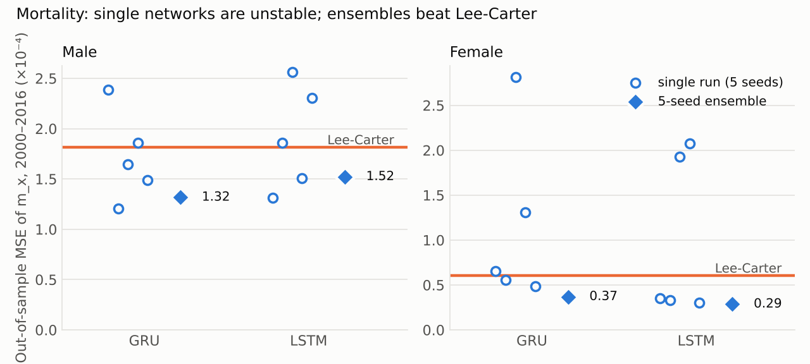
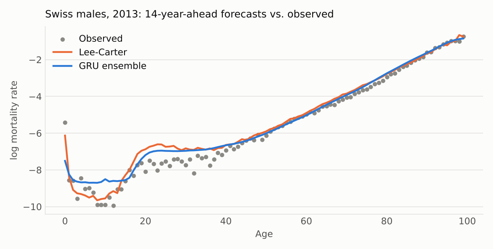

# Actuarial Mortality Forecasting: Lee-Carter vs. Recurrent Neural Networks

Do recurrent neural networks forecast mortality better than the Lee-Carter model? This project forecasts Swiss age-specific mortality rates (ages 0 to 99, Human Mortality Database), training on 1950–1999 and forecasting 2000–2016 recursively, one calendar year at a time, for both sexes.

It started as a course assignment in statistical learning for the B.Sc. Actuarial Science programme at the University of International Business and Economics (UIBE), Fall 2024, submitted in R (`original-R/`), and was later re-implemented and extended in Python with a Lee-Carter benchmark, an LSTM, female mortality and multi-seed ensembles.

## Headline results

- **Single networks are unreliable.** Only 10 of 20 single training runs beat Lee-Carter out of sample; the male GRU ranged from 33% better to 31% worse depending on the random seed.
- **Ensembles are reliable.** Averaging 5 seeds beat Lee-Carter in all four model–sex combinations. The GRU ensemble cut the out-of-sample MSE of mortality rates by 27% (male) and 39% (female).
- **The gain is at older ages.** On the log scale, which weights all ages equally, Lee-Carter remains more accurate: the networks smooth out the low mortality of children and young adults.



## Methods

1. **Lee-Carter benchmark.** Fitted by singular value decomposition of the centred log rates; the period index is extrapolated as a random walk with drift.
2. **GRU** (the original assignment). Three recurrent layers with 20, 15 and 10 units, Adam, batch size 100, 500 epochs. Each input is a 10-year × 5-age window of log mortality rates, and the target is next year's rate at the centre age. 20% of the training samples are held back, and the weights from the epoch with the lowest validation loss are kept, to control over-fitting.
3. **LSTM** with the same architecture, and both networks for females as well as males.
4. **Seed ensembles.** Every network is trained with 5 random seeds; the ensemble forecast is the average of the 5 log-rate forecasts.

## Results

Out-of-sample error over 2000–2016. MSE of the mortality rates m_x × 10⁴, with RMSE of log mortality in brackets:

| Model | Male | Female |
|---|---|---|
| Lee-Carter | 1.815 (0.381) | 0.604 (0.359) |
| GRU, single runs (range over 5 seeds) | 1.208 – 2.386 | 0.484 – 2.818 |
| GRU, 5-seed ensemble | **1.317** (0.418), −27% | **0.368** (0.424), −39% |
| LSTM, single runs (range over 5 seeds) | 1.313 – 2.561 | 0.303 – 2.078 |
| LSTM, 5-seed ensemble | 1.521 (0.453), −16% | **0.286** (0.389), −53% |

The Lee-Carter figures match the reference values in the course code (in-sample 8.811 male and 3.757 female; out-of-sample 0.604 female), a check that the data handling and the metrics are right.



## Repository layout

```
mortality_forecast.py   data preparation, Lee-Carter, GRU/LSTM training, recursive forecasts, ensembles
make_figures.py         draws the charts in figures/ from results/
data/                   Swiss mortality rates (Gender;Year;Age;Country;imputed_flag;mx;logmx)
results/                all numbers: every run, every ensemble, errors by year, forecasts by age
original-R/             the original R submission (GRU, male mortality)
```

## Reproducing

```bash
pip install -r requirements.txt
python mortality_forecast.py data/mortality_CHE.csv results 5   # about 45 min on a laptop CPU
python make_figures.py
```

Seeds are fixed, but neural network results can differ slightly across TensorFlow versions and hardware.

## Data and acknowledgements

Mortality data: Human Mortality Database, University of California, Berkeley (USA), and Max Planck Institute for Demographic Research (Germany), www.mortality.org, published under CC BY 4.0. The file in `data/` is the course's prepared extract of the Swiss series.

The modelling setup and the original R code follow the course material, which is based on M. V. Wüthrich and M. Merz (2023), *Statistical Foundations of Actuarial Learning and its Applications*, Springer (open access).

Author: Miaomiao Cui
